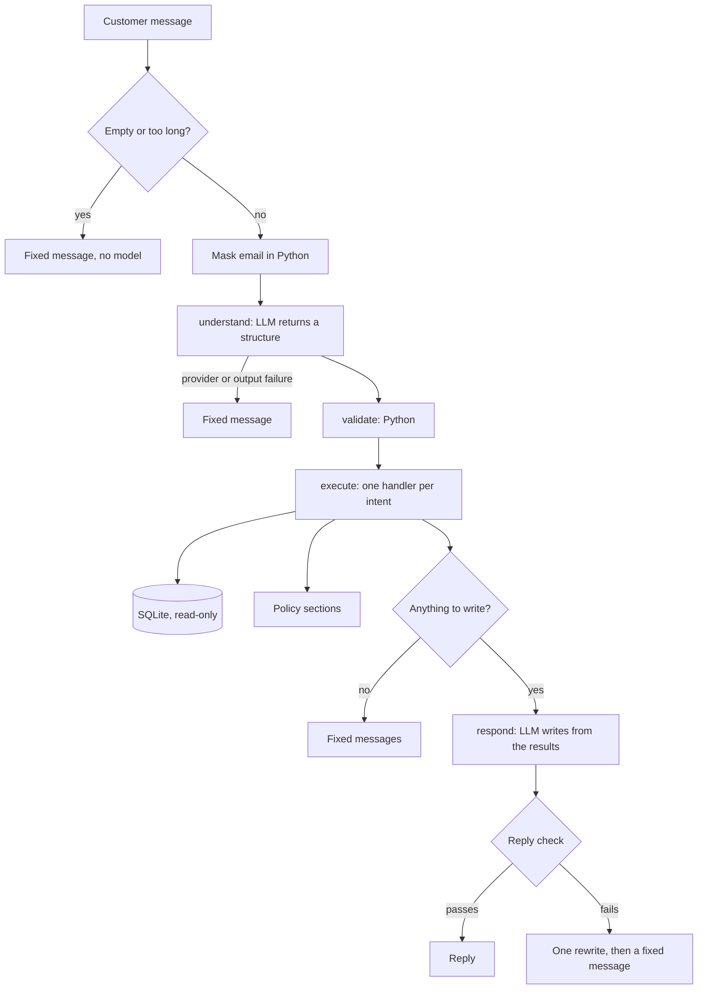

# Architecture

## One turn

A greeting skips the model in `understand`, and the price of a product that can be bought is a
sentence from code, so it skips the model in `respond`.

## Where each thing lives

| Layer | Path | Responsibility |
| --- | --- | --- |
| Interfaces | `app.py`, `main.py` | Show messages and call the service. No logic |
| Service | `agent/service.py` | Public chat API, sessions in memory, email masking, message limits |
| Workflow | `agent/graph.py` | The four steps and the closed table of handlers |
| Model adapter | `agent/llm.py` | The only code that knows the provider |
| Prompts | `agent/prompts.py` | Versioned prompts and every fixed message |
| Reply check | `agent/guards.py` | What can be verified without understanding the sentence |
| Tools | `tools/` | Catalog, orders, policies and store information, with no model involved |
| Domain | `domain/` | Contracts, pricing rules and what the store sells |
| Data | `data/` | CSV import, read-only queries and the policy index |
| Events | `observability/` | JSON events with an allow-list, so no message text is logged |

## Who decides what

| Decision | Who |
| --- | --- |
| What the customer is asking for | Model, inside a validated structure |
| Which code runs | Python, from a closed table |
| Prices, discounts, availability | Python, from the data. The model restates them when it writes |
| Whether an order can be shown | Python, comparing an email taken out of the message first |
| Which product "esse" or "a segunda" means | Python, from the session state, using the model's reading |
| Which manual sections apply | Python, by lexical score |
| How a policy applies to the customer's case | Model, from the sections and notes written in code |
| The wording of a reply | Model, within the data it received |
| Whether the reply is sent | Python, by looking for values absent from the data, not by judging if it is true |

A name that the last list does not contain is treated as explicit and looked up in the catalog. Only a
single product shown or chosen stays in focus, so a new list clears the previous one.

## What the model receives

Neither step has direct access to the database. They only see what is listed here.

**In `understand`:** the rules, the recent conversation with emails masked, and short context such as
the last list shown. That conversation can hold prices and order details from earlier replies.

**In `respond`:** the rules, the results of this turn in a `<dados>` block, the customer's last messages
and its own previous reply. A price written by code in the same turn is included as `already_in_reply`,
so the rest of the reply can agree with it. If the message was marked as partly off topic, it is
withheld and replaced by its subject.

## Trade-offs

- **Python makes most of the decisions.** This is safer and testable, but unusual conversations need
  a path in code. Several fixes here were exactly that.
- **Two model calls in a normal turn,** plus at most one retry for each if the output is unusable.
  This keeps cost and time predictable, and rules out multi-step reasoning. A message runs at most
  two actions.
- **The reply check reads patterns.** It catches an amount or link that is nowhere in the data. It
  cannot judge whether a sentence is true, and a price attached to the wrong product passes.
- **Everything is local and read-only.** It is easy to run and hard to break, and the data is a
  snapshot that the agent can never change.

## What would change in production

Live APIs instead of CSV files, real authentication for orders, conversations stored between sessions,
rate limiting, events sent to a monitoring tool, a hand-over to the team with the conversation attached,
and real conversations feeding the evaluation sets. The agent's structure would stay the same.
